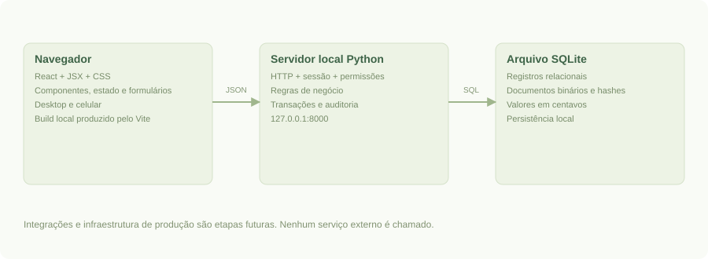
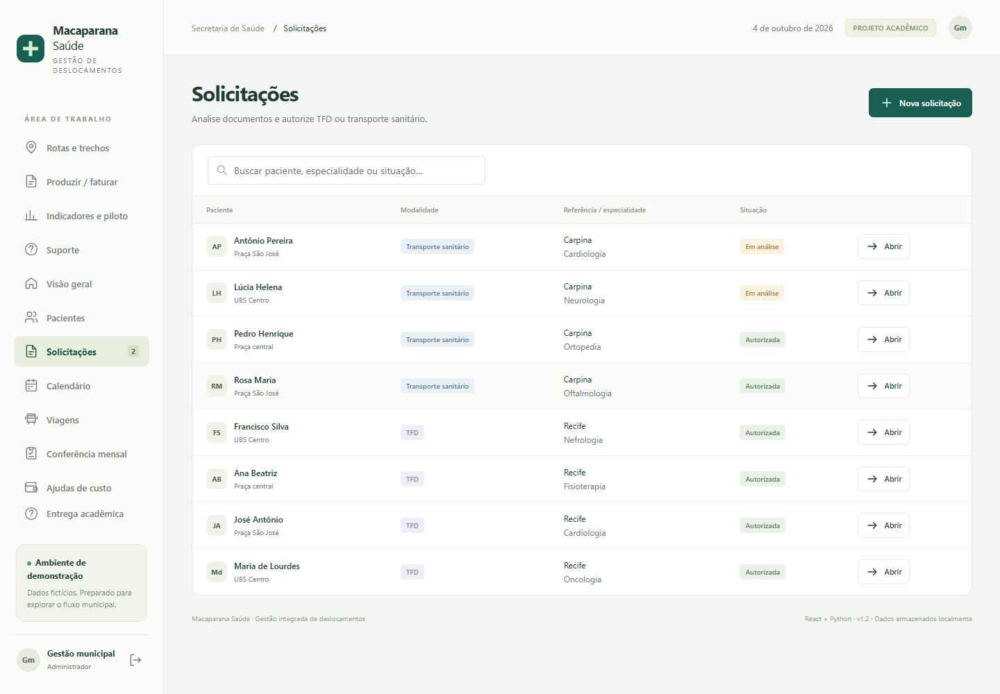
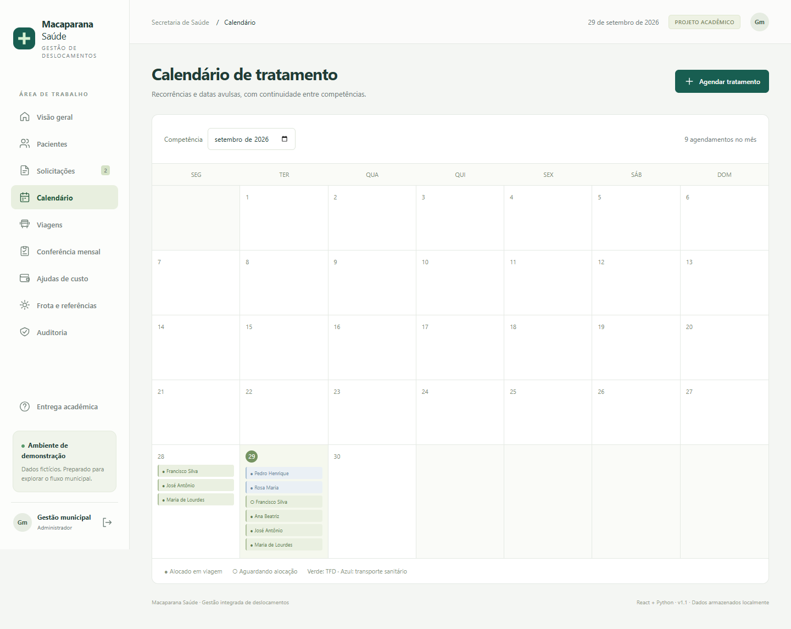
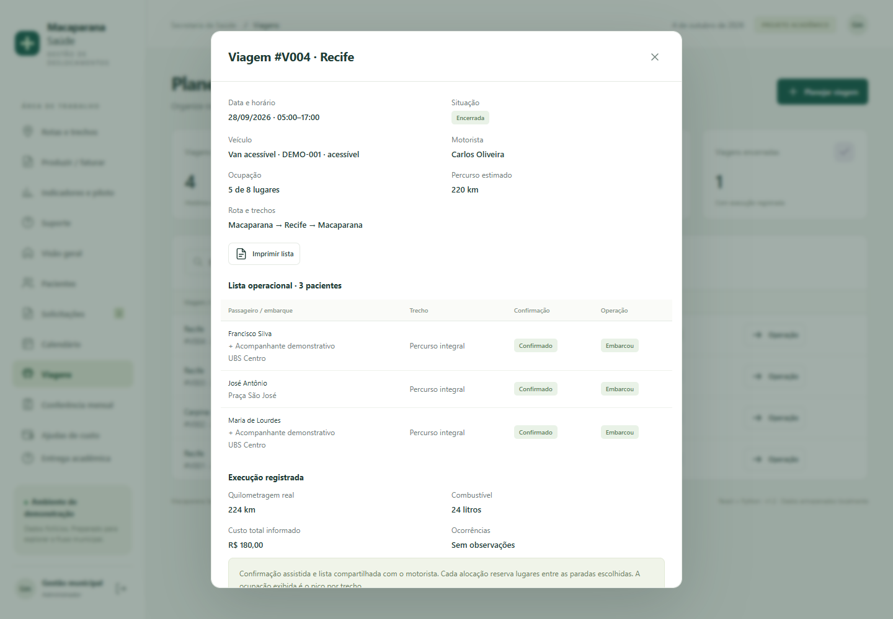
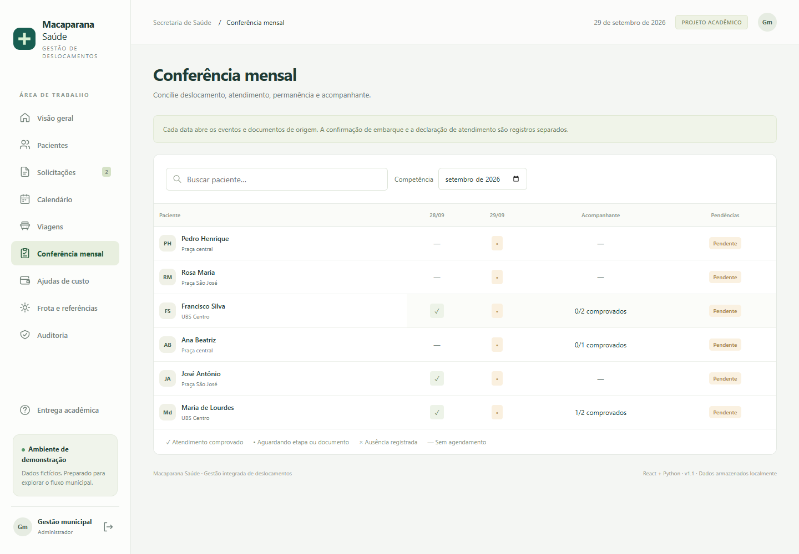
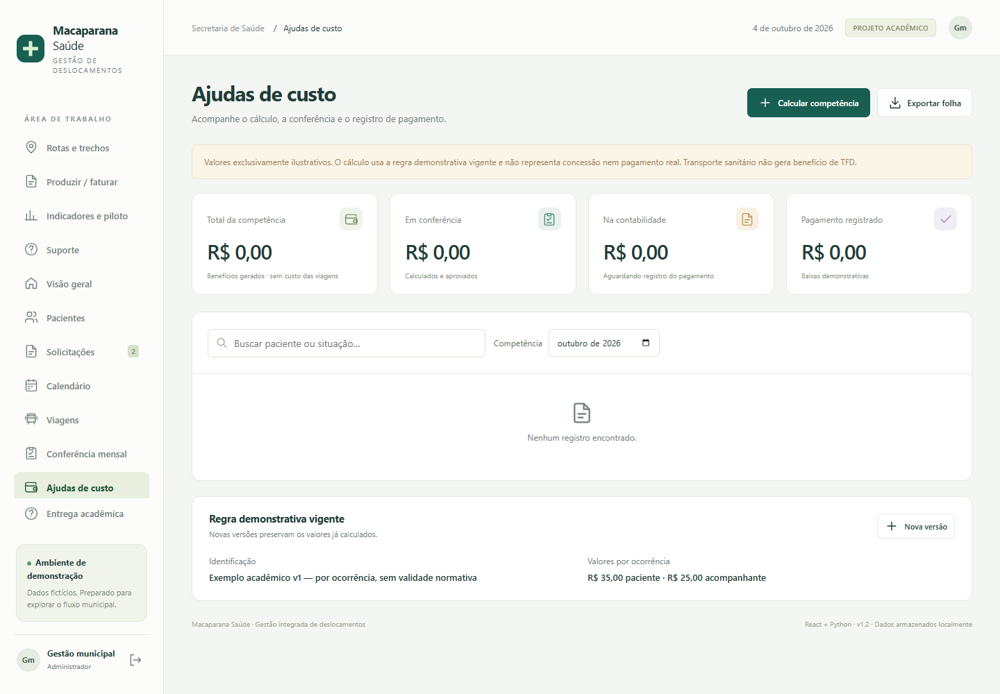

# Macaparana Saúde

## Guia completo para apresentação e defesa do projeto

Sistema acadêmico funcional de gestão de TFD, transporte sanitário e ajudas de custo. Material preparado a partir do código, dos requisitos fornecidos e das evidências locais de teste. Revisão técnica de referência: 04/10/2026.

**Objetivo da apresentação:** demonstrar como a solução acompanha o paciente, organiza a operação e relaciona comprovação, custos e responsabilidade por cada etapa.

**Condição da entrega:** aplicação local integrada, com dados fictícios, documentação, protótipo navegável, testes e capturas. Integrações oficiais e piloto municipal real permanecem dependentes da prefeitura.

Repositório privado: https://github.com/anabeatrizvc-cloud/macaparana-saude

<!-- PAGE -->
# 1. Entenda a proposta antes de demonstrar

O enunciado de Macaparana pede uma solução para acompanhar pessoas que precisam de atendimento fora do município. Isso envolve mais do que transportar alguém: é necessário analisar a solicitação, planejar datas, reservar recursos, comprovar o atendimento e controlar eventual benefício.

A proposta organiza essas informações em um mesmo sistema. O cadastro do paciente é reutilizado nas solicitações; cada solicitação autorizada pode gerar várias datas; cada data pode ser vinculada a uma viagem, documentos e benefícios. Assim, a equipe consegue consultar a origem de um registro financeiro ou operacional.

O projeto atende diretamente pacientes, acompanhantes e equipes municipais. As unidades de referência e outros municípios são beneficiários indiretos; não há portal externo específico para essas instituições nesta versão.

### Problema, resposta e valor esperado

| Necessidade apresentada | Resposta do projeto | Valor esperado, ainda sujeito ao piloto |
|---|---|---|
| Conciliar informações de setores diferentes | Registros vinculados por identificadores | Menos retrabalho e maior facilidade de conferência |
| Planejar transporte e acompanhamento | Agenda, frota, motorista, acessibilidade e trechos | Melhor visibilidade da capacidade e da operação |
| Identificar documentos e responsáveis | Anexos e auditoria | Conferência com origem verificável |
| Relacionar custos e atendimentos | Painéis, viagens, benefícios e produção | Apoio à decisão com dados locais |

Não foi realizado diagnóstico de campo que permita afirmar quanto o município economiza hoje ou quanto economizaria com a solução. Essas são hipóteses de benefício a medir.

### Fala sugerida para a abertura

> “O Macaparana Saúde foi desenvolvido para integrar o processo de deslocamento em saúde: da solicitação ao acompanhamento financeiro. A proposta permite distinguir quem foi agendado, quem viajou, quem comprovou atendimento e qual é a situação do benefício, mantendo os documentos e os eventos relacionados.”

<!-- PAGE -->
# 2. Conceitos que você precisa explicar

| Termo | Significado no projeto |
|---|---|
| SUS | Sistema Único de Saúde, contexto do público atendido no enunciado |
| TFD | Tratamento Fora do Domicílio; modalidade separada no cadastro e no cálculo demonstrativo |
| Transporte sanitário | Transporte para atendimento sem gerar automaticamente benefício de TFD |
| CNES | Identificador do estabelecimento de saúde, informado manualmente na referência |
| CNS | Identificador do usuário de saúde; campo de cadastro com validação de formato |
| Competência | Mês usado para organizar conferência, calendário e consultas financeiras |
| Ocorrência | Uma data de atendimento vinculada à solicitação |
| Comprovação | Registro apoiado por declaração anexada e informações de permanência |
| Produção | Preparação interna de dados de atendimento para revisão pelo faturamento |
| Rastreabilidade | Possibilidade de relacionar um registro à sua origem e às alterações registradas |

### Quatro fatos diferentes

**Deslocamento:** o passageiro embarcou ou ficou ausente. **Atendimento:** há comprovação vinculada à ocorrência. **Benefício:** foi gerado um valor segundo uma regra demonstrativa. **Pagamento:** a equipe registrou a etapa financeira e uma data.

Esses fatos são mantidos em campos e registros diferentes. Embarcar não comprova atendimento. Comprovar atendimento não significa ter recebido dinheiro. A modalidade de transporte sanitário não é convertida automaticamente em TFD.

### Exemplo para a banca

Uma paciente pode confirmar presença, embarcar e ainda ter a declaração pendente. Nesse caso, o sistema registra o deslocamento, mas não deve tratá-lo como atendimento comprovado. Se houver acompanhante, sua comprovação é independente da declaração da paciente.

Este material descreve o comportamento do software. Critérios normativos, valores e elegibilidade reais devem ser homologados pelo município; os valores da demonstração não são parâmetros legais.

<!-- PAGE -->
# 3. Tecnologias utilizadas e suas funções

| Tecnologia | Uso concreto no projeto | Motivo da escolha para esta entrega |
|---|---|---|
| Python | Servidor HTTP, regras de negócio, autenticação, consultas e exportações | Executar localmente com poucas dependências |
| React e React DOM | Interface com componentes, formulários, estado e navegação | Compartilhar dados entre telas e atualizar a experiência após cada operação |
| JavaScript e JSX | Lógica da interface e descrição dos componentes | Organizar a interação com o usuário |
| HTML e CSS | Estrutura visual, impressão e adaptação ao celular | Apresentar formulários e tabelas de forma legível |
| Vite | Ambiente de desenvolvimento e geração do frontend compilado | Produzir os arquivos estáticos que o Python entrega ao navegador |
| SQLite | Banco local com relacionamentos, documentos e auditoria | Persistência sem instalar um serviço separado de banco |
| JSON e HTTP | Comunicação entre navegador e servidor | Transportar solicitações e respostas estruturadas |
| Git e GitHub | Histórico e armazenamento do código | Versionar e permitir revisão do projeto |

O `package.json` declara React/React DOM `^19.3.0`, Vite `^8.3.1`, plugin React `^6.1.1` e Prettier `^3.9.9`. O arquivo de lock acompanha o projeto para registrar a instalação das dependências. Python 3.14.4 aparece na evidência dos testes. Essas informações descrevem o ambiente do projeto, não uma recomendação de versões para produção.

### Ferramentas de desenvolvimento e documentação

Node.js e npm foram usados para instalar dependências e compilar o frontend. Prettier organiza o código. `unittest` testa regras e HTTP. Playwright controla o navegador nos testes e capturas. Markdown estrutura a documentação; Chromium gera os PDFs; PyMuPDF permite conferir o conteúdo dos PDFs. Mermaid e SVG representam processos e arquitetura.

**Na apresentação:** a interface já está compilada. Basta Python e um navegador; não é necessário executar npm ou acessar sistemas externos para abrir a entrega. O backend usa a biblioteca padrão do Python: não utiliza Django ou Flask. O frontend utiliza componentes React reais, não apenas imagens de telas.

<!-- PAGE -->
# 4. Como as partes se comunicam



1. O usuário preenche uma tela React e solicita uma ação.
2. A interface envia dados em JSON à API Python.
3. O servidor identifica a sessão e verifica a permissão do perfil.
4. As regras verificam validade, vínculos e condições da operação.
5. O SQLite registra a alteração e o evento de auditoria na transação.
6. A interface consulta o estado atualizado e mostra o resultado.

### Exemplo: alocar um passageiro

Ao clicar em alocar, o servidor verifica se a solicitação está autorizada, se a data corresponde à viagem, se há veículo acessível quando necessário e se o intervalo de paradas tem capacidade. Se alguma condição falhar, a operação retorna uma mensagem e não deve efetivar uma alocação inválida.

### Por que a regra fica no servidor?

O navegador ajuda a preencher os campos, mas não é a autoridade final. Uma tentativa de enviar dados diretamente à API também precisa passar pelas validações do Python. Isso é especialmente importante para permissões, capacidade, comprovação e geração de benefícios.

### Persistência e escopo de execução

Os registros ficam no arquivo SQLite, não apenas na memória da página. Recarregar a interface ou reiniciar o servidor preserva os dados salvos. A sessão de login, por outro lado, fica na memória do servidor e pode exigir novo acesso após reinício. O endereço local não significa que o sistema esteja publicado na internet.

<!-- PAGE -->
# 5. Organização do código e do banco

| Arquivo ou pasta | Responsabilidade |
|---|---|
| `server.py` | Servir a interface, receber HTTP, controlar sessão e expor a API |
| `app/domain.py` | Regras principais de cadastro, autorização, agenda, viagem, comprovação e benefício |
| `app/extensions.py` | Trechos, preparação da produção, suporte, piloto e migração complementar |
| `app/schema.sql` | Estrutura inicial do banco relacional |
| `app/seed.py` | Inicialização dos perfis e registros fictícios |
| `frontend/src/` | Componentes, formulários, detalhes, telas e contexto React |
| `static/build/` | Frontend compilado que acompanha a entrega |
| `tests/` | Testes das regras e das requisições HTTP |
| `scripts/` | Automação de teste, captura, documentação, backup e empacotamento |
| `docs/` | PDFs, fontes editáveis, diagramas e evidências |

### Relações principais

Um **paciente** possui solicitações. A **solicitação** aponta para a referência, modalidade, especialidade e período autorizado. A **ocorrência** representa uma data da solicitação e pode apontar para uma viagem. A **viagem** aponta para veículo, motorista e paradas. O **documento** pertence à solicitação ou à ocorrência. O **benefício** aponta para a ocorrência e a versão da regra. A **produção** preparada também aponta para a ocorrência.

As tabelas complementares registram paradas, produção, suporte/capacitação e medições do piloto. A auditoria registra autor, ação, entidade, horário e conteúdo de alteração quando aplicável.

### Decisões importantes

Chaves estrangeiras ajudam a preservar vínculos. A agenda usa unicidade por solicitação e data. O benefício usa unicidade por ocorrência e beneficiário. Valores financeiros são armazenados em centavos. Os anexos ficam no banco com hash e metadados. As tabelas complementares são criadas na inicialização e as colunas novas são adicionadas sem apagar a base existente.

O modelo é adequado ao demonstrador, mas mantém simplificações: um acompanhante atual por paciente, permanência textual e viagens com saída/retorno no mesmo dia.

<!-- PAGE -->
# 6. Quem utiliza cada área

| Perfil de login | Papel demonstrado |
|---|---|
| `admin` | Executa as ações administrativas e todos os fluxos da demonstração |
| `regulacao` | Mantém cadastros, solicitações, documentos, decisões, agenda e comprovação |
| `transporte` | Planeja recursos, viagens, paradas, alocações e operação |
| `motorista` | Acessa suas viagens e dados operacionais; confirma, registra embarque/ausência e execução |
| `financeiro` | Calcula benefícios demonstrativos e acompanha etapas até pagamento |
| `faturamento` | Prepara produção, registra encaminhamento para revisão e exporta dados internos |
| `auditor` | Consulta auditoria e dados de controle; registra medições do piloto e abre registros de suporte/capacitação |

Todos os perfis acadêmicos usam `demo123`. Essa senha pública facilita a demonstração com dados fictícios. Uma operação real exige contas individuais e política de acesso própria.

### O que demonstrar sobre proteção de dados

Entre como motorista e mostre que a API entrega apenas as viagens desse motorista e uma seleção de dados operacionais. Esse perfil não recebe CPF, CNS, dados bancários, documentos clínicos ou especialidade nos objetos projetados. Não basta esconder um botão: há restrição na resposta do servidor e nas ações permitidas.

O perfil de transporte também recebe dados reduzidos. Financeiro, regulação, faturamento e controle possuem acessos relacionados às suas tarefas; essa distribuição deverá ser validada com o município antes do uso real.

### Observação para a defesa

O perfil de auditor não autoriza solicitações nem paga benefícios, mas pode registrar medições e chamados conforme a implementação atual. Evite dizer que ele é absolutamente incapaz de escrever no sistema.

<!-- PAGE -->
# 7. Cadastro, solicitação e autorização

### Requisitos atendidos

Paciente e acompanhante; endereço; ponto de embarque; dados bancários; referência com CNES; especialidade; laudo; solicitação, análise e autorização; diferenciação de modalidades.

O cadastro reúne nome, identificação, nascimento, contato, endereço, ponto de embarque, necessidade de acessibilidade, acompanhante e campo bancário. Os campos de identificação possuem validação de formato; isso não equivale a uma consulta a uma base oficial.

Uma solicitação reutiliza o paciente e a unidade de referência ativa. A equipe escolhe a modalidade, informa especialidade, período e necessidade de acompanhante. O laudo é anexado à solicitação. A decisão pode autorizar, deixar pendente ou negar, com justificativa.

**Bloqueio relevante:** a autorização exige laudo anexado. O acompanhante precisa estar cadastrado quando a solicitação o prevê. A validade inicial e final precisa ser coerente.



**Como explicar:** “O cadastro evita repetir o paciente a cada mês. A solicitação reúne a análise assistencial e a autorização; as datas de tratamento serão geradas a partir dela.”

<!-- PAGE -->
# 8. Calendário e continuidade entre competências

### Requisitos atendidos

Recorrências semanais, datas avulsas, reutilização da autorização dentro da validade e acompanhamento entre meses.

A equipe escolhe a solicitação autorizada, o período e os dias da semana. O sistema gera uma ocorrência para cada data aplicável. Para um atendimento avulso, informa-se a mesma data no início e no fim. As datas precisam estar dentro da validade da autorização.

Uma autorização pode abranger vários meses. A visualização muda por competência, mas os registros continuam vinculados à mesma solicitação. Gerar novamente uma série não duplica datas existentes para aquela solicitação.



### Exemplo para demonstrar

Autorize um caso fictício por dois meses e selecione um dia semanal. Mostre datas em duas competências e repita a geração. Explique que a unicidade está protegida no banco e que o teste automatizado verifica essa continuidade.

**Limite:** o sistema não tem uma entidade independente de tratamento com suspensão e revisão completa de séries. Nesta versão, a solicitação autorizada agrupa as ocorrências.

<!-- PAGE -->
# 9. Viagens, recursos e trechos

### Requisitos atendidos

Veículos, motoristas, capacidade, acessibilidade, rotas, data, trecho e registro de alterações.

Uma viagem define data, horários, destino, rota, veículo, motorista e quilometragem estimada. O servidor verifica disponibilidade, validade da CNH e conflito de horário do veículo ou motorista. A alocação exige ocorrência na data da viagem e autorização válida.

Em Rotas e trechos, a equipe define paradas ordenadas. O passageiro ocupa lugares entre o embarque e o desembarque planejados. O acompanhante também ocupa uma vaga. Um passageiro que desce em uma parada libera capacidade planejada nos segmentos seguintes.

### Exemplo simples de capacidade

| Segmento | Capacidade | Reserva do paciente A + acompanhante | Reserva do paciente B |
|---|---|---|---|
| Macaparana → Carpina | 2 | 2 lugares | Não cabe nesse segmento |
| Carpina → Recife | 2 | 0, se o desembarque foi em Carpina | Pode reservar até a capacidade disponível |

Esse é um exemplo didático, não um resultado municipal. O teste de trechos verifica a reutilização de vaga em intervalos distintos e o bloqueio de intervalos sobrepostos sem capacidade.

Alterar paradas exige viagem planejada, sem alocações e justificativa. Para reorganizar a rota, a equipe retira alocações ainda pendentes, registra o motivo e aloca novamente. Não é permitido retirar passageiros após registrar embarque ou ausência.

**Limites:** a rota não é calculada por mapa, não existe GPS e o embarque é registrado por ocorrência. A capacidade por trecho representa reserva, não rastreamento físico de cada desembarque.

<!-- PAGE -->
# 10. Confirmação e lista do motorista

### Requisitos atendidos

Confirmação antecipada, alternativa assistida, lista operacional e execução da viagem.

A equipe registra confirmação ou recusa, canal e observação. O canal pode ser telefone, atendimento presencial, agente de saúde ou resposta recebida externamente por WhatsApp autorizado. Selecionar WhatsApp no registro não envia mensagem pelo aplicativo.

O motorista consulta sua lista com paciente, acompanhante, ponto de embarque, trecho, confirmação e situação operacional. A lista também pode ser aberta em formato de impressão. A confirmação alimenta a mesma ocorrência usada pelo planejamento.

O embarque exige confirmação, salvo o registro de ausência. Não se registra embarque futuro. Para encerrar a viagem, todos os passageiros precisam ter embarque ou ausência registrados. No encerramento são informados quilômetros reais, litros, custo e observações.



**Fala sugerida:** “A alternativa assistida permite que a equipe registre a resposta do cidadão sem exigir que ele use um aplicativo. O motorista trabalha com a lista atualizada, enquanto a informação permanece vinculada ao atendimento.”

<!-- PAGE -->
# 11. Conferência mensal e comprovação

### Requisitos atendidos

Tabela compacta de pacientes e datas; conciliação entre declaração, viagem e permanência; comprovação separada do acompanhante.

A conferência mensal mostra as ocorrências por paciente e data. A célula leva ao detalhe, permitindo consultar os registros e documentos relacionados. A equipe pode distinguir transporte realizado, atendimento comprovado e pendência documental.

A comprovação do paciente exige embarque registrado, declaração anexada e descrição de permanência. A comprovação do acompanhante exige autorização correspondente e declaração separada. A presença de um documento do paciente não comprova automaticamente o acompanhante.



### O que valorizar na apresentação

Abra uma ocorrência e mostre como os documentos sustentam o registro. Explique que deslocamento e atendimento permanecem distintos. Se faltar a prova do acompanhante, o sistema pode ter paciente comprovado e acompanhante pendente.

**Limite:** a permanência é texto obrigatório. Pernoites, períodos estruturados e regras detalhadas de diárias precisam de evolução e homologação municipal.

<!-- PAGE -->
# 12. Ajudas de custo e controle financeiro

### Requisitos atendidos

Folha de ajudas de custo, encaminhamento à contabilidade, acompanhamento do pagamento e etapas separadas.

O cálculo demonstrativo considera ocorrências de TFD autorizadas, com embarque e atendimento comprovados. O benefício do acompanhante depende de sua comprovação separada. Transporte sanitário não gera benefício de TFD nessa regra.

Cada benefício mantém o beneficiário, a ocorrência, o valor em centavos e a versão da regra utilizada. Recalcular não duplica benefícios existentes. Criar uma nova versão de regra não muda os valores já gerados.

### Etapas financeiras

**Calculado → Aprovado → Contabilidade → Pago.** O encaminhamento e o pagamento exigem referência contábil. O pagamento exige data coerente com o atendimento e não futura. A folha pode ser exportada para conferência.



**Explique com precisão:** “Registrar pagamento significa acompanhar a informação no sistema. O software não transfere dinheiro e não consulta a conta bancária. Os valores demonstrativos não foram homologados para pagamento real.”

<!-- PAGE -->
# 13. Preparação da produção e faturamento

### Requisito atendido

Preparar dados de produção para revisão e posterior uso nos sistemas oficiais, com vínculos até os eventos de origem.

O perfil de faturamento consulta uma competência e identifica pendências de transporte, comprovação e preparação. Somente ocorrências conciliadas podem gerar o registro preparado. A equipe informa código de procedimento, quantidade, destino da revisão e observações.

O código é verificado quanto ao formato de dez dígitos; a aplicação não consulta o catálogo oficial para confirmar existência, elegibilidade ou compatibilidade. A exportação CSV contém identificadores de preparação, ocorrência e solicitação, além dos dados necessários à conferência interna.

Ao encaminhar, registra-se protocolo interno. O estado passa para encaminhada para revisão. Uma nova preparação não sobrescreve um registro já encaminhado.

### Diferencie três etapas

| Etapa | Situação na entrega |
|---|---|
| Organizar e conciliar os registros | Implementado |
| Preparar e encaminhar internamente para revisão | Implementado, com CSV e protocolo |
| Transmitir e obter aceite de um sistema oficial | Não integrado; depende de interface, regras e homologação |

**Fala sugerida:** “Nós entregamos a preparação rastreável da produção. O arquivo não é apresentado como um leiaute oficial. A etapa de transmissão precisa ser definida e autorizada com o município.”

É necessário revisar CNS, CNES, código, modalidade, quantidade e exigências do destinatário. Dados fictícios e códigos usados nos testes não têm validade de produção oficial.

<!-- PAGE -->
# 14. Indicadores e resultados do piloto

### Requisitos atendidos no software

Relacionar informações assistenciais, operacionais e financeiras; oferecer indicadores e permitir o registro de medições do piloto.

| Indicador | Cálculo ou definição implementada |
|---|---|
| Custo das viagens encerradas | Soma dos custos informados nas viagens encerradas da competência |
| Quilômetros reais | Soma dos quilômetros dessas viagens |
| Consumo em km/l | Quilômetros divididos pelos litros registrados; sem divisão por zero |
| Custo por embarque | Custo das viagens encerradas dividido pelos embarques de pacientes nessas mesmas viagens |
| Embarques e ausências | Contagem de ocorrências com cada estado na competência |
| Comprovações pendentes | Ocorrências com embarque, mas sem atendimento comprovado |
| Ocupação por trecho | Lugares reservados em cada intervalo de paradas, incluindo acompanhante |

O custo de transporte não inclui as ajudas de custo. A ocupação por trecho é planejada; não mede presença física individual do acompanhante. Essas definições evitam misturar numeradores e denominadores.

### Registro de medição

O formulário guarda indicador, unidade, linha de base, resultado, período, fonte, responsável e origem: simulação acadêmica ou rotina municipal. A variação percentual é `(resultado − base) / base × 100`; base zero impede essa comparação percentual.

Registrar um número não comprova o resultado. É necessário conservar uma fonte verificável, usar períodos comparáveis e explicar volume, critérios e limitações. Uma variação negativa pode ser boa para tempo de espera e ruim para quantidade de atendimentos; a interpretação depende do indicador.

**O que pode ser afirmado hoje:** existem ferramentas de medição e testes locais. Não houve piloto municipal comprovado nem economia real demonstrada.

<!-- PAGE -->
# 15. Segurança, auditoria e continuidade

### Medidas implementadas

As senhas são derivadas com PBKDF2-HMAC-SHA256 e salt; não são armazenadas como texto simples. A sessão usa token aleatório no servidor e cookie HttpOnly/SameSite. As ações possuem controle de perfil no backend. Requisições de alteração exigem identificação da aplicação e verificam origem local quando informada.

Consultas usam parâmetros nos valores. O banco usa chaves estrangeiras e transações. Os anexos aceitam tipos definidos e limite de tamanho, com download autenticado. Eventos de alteração, acesso por login, download e exportação geram auditoria conforme o fluxo implementado.

Um hash do documento ajuda a identificar seu conteúdo armazenado; não é uma assinatura digital e não comprova autenticidade clínica. A auditoria local não é um repositório imutável contra alguém que controla o arquivo do banco.

### Backup

`python scripts/backup.py` cria uma cópia consistente do SQLite, verifica integridade e não sobrescreve um destino existente. O teste reabre a cópia e consulta os registros. Banco e backups ficam fora do Git e do pacote de distribuição.

### Limites que precisam ser reconhecidos

O banco não tem criptografia própria configurada. As contas são demonstrativas. Não há MFA, antivírus de anexos, infraestrutura de produção, teste de invasão completo ou certificação de conformidade. O ambiente local usa HTTP em loopback.

Antes de dados reais, o município precisa definir responsabilidades, finalidade, retenção, contas individuais, infraestrutura protegida, HTTPS, acesso ao armazenamento, backup externo, recuperação e resposta a incidentes. A apresentação deve mostrar as medidas técnicas existentes sem declarar conformidade jurídica integral.

<!-- PAGE -->
# 16. Capacitação, suporte e implantação futura

O projeto inclui manual, roteiro e área para registrar capacitações e chamados. O registro informa tipo, título, responsável, descrição e situação. A conclusão conserva a observação anterior e acrescenta a solução ou evidência. Não existe equipe de suporte externo contratada pelo projeto.

### Oficina proposta de 90 minutos

| Tempo | Exercício |
|---|---|
| 10 minutos | Acesso, perfis e cuidado com os dados |
| 20 minutos | Cadastro, solicitação, laudo, decisão e calendário |
| 20 minutos | Rota, trechos, confirmação, lista e execução |
| 20 minutos | Declarações, conferência, benefício e etapas financeiras |
| 10 minutos | Preparação da produção e revisão interna |
| 10 minutos | Auditoria, chamado e registro de medição |

Uma oficina só deve ser marcada como concluída quando realizada. Os registros nas capturas são fictícios e demonstram o funcionamento do formulário.

### Etapas para o município

1. Validar processos e regras com cada equipe e definir responsáveis.
2. Preparar infraestrutura, acesso e proteção dos dados.
3. Homologar valores, critérios financeiros e produção oficial.
4. Capacitar a equipe e executar um piloto controlado.
5. Medir resultados com fontes, revisar incidentes e decidir sobre expansão.

Para replicar em outro município, será necessário revisar regras, identidade visual, cadastros, infraestrutura e responsabilidades. O código pode servir de base; a versão atual não é uma plataforma multi-município com isolamento de bases por cliente.

<!-- PAGE -->
# 17. Evidências: o que realmente foi verificado

**27 testes automatizados aprovados** na revisão de 04/10/2026, conforme `docs/resultado-testes.txt`. A contagem reúne testes de domínio, extensões e HTTP; não é uma afirmação de cobertura total do código.

| Grupo | Exemplos de comportamento verificado |
|---|---|
| Autorização e calendário | Exigência de laudo, validade, recorrência entre meses e duplicidade |
| Transporte | Conflitos de recurso, CNH, acessibilidade, capacidade e acompanhante |
| Trechos | Reutilização de vaga sem sobreposição e bloqueio de excesso de capacidade |
| Comprovação e financeiro | Prova independente, modalidade sem TFD, recálculo e pagamento |
| API e perfis | Sessão, origem, restrição do motorista, downloads e exportações |
| Complementos | Produção comprovada, preservação após encaminhamento, piloto e suporte |
| Dados | Migração preservada e backup que pode ser reaberto |

### Teste no navegador

O arquivo `docs/teste-navegador.json` registra um fluxo com resultado PASS: cadastro, solicitação, laudo, autorização, agenda, viagem, confirmação, embarque, encerramento, declaração, comprovação, cálculo, aprovação, contabilidade, pagamento e recarga. Não foram registrados erros JavaScript nessa execução.

O arquivo `docs/revisao/resultado.json` registra os novos fluxos, sete capturas e verificação das quatro novas telas em largura de 390 pixels. Há também 49 capturas históricas do fluxo anterior e 13 telas do protótipo. São conjuntos distintos, não 69 testes independentes.

O pacote foi extraído em uma pasta temporária, teve seus hashes conferidos e iniciou com base limpa. Esse teste valida a distribuição local, não desempenho em produção ou integração com serviços oficiais.

**Resposta recomendada:** “Testamos as regras críticas e o fluxo integrado. Ainda seriam necessários testes de carga, segurança ampliada, acessibilidade formal e homologação municipal para produção.”

<!-- PAGE -->
# 18. Matriz de atendimento aos requisitos

Use esta matriz para responder diretamente ao enunciado. “Implementado” significa funcional no demonstrador; não significa homologado para uso real.

| Requisito | Funcionalidade que responde | Condição |
|---|---|---|
| Pacientes e acompanhantes | Cadastro com vínculo e acessibilidade | Um acompanhante atual por paciente |
| Transporte sem enquadramento em TFD | Modalidade própria na solicitação | Não gera ajuda de TFD pela regra demonstrativa |
| Solicitação, análise e autorização | Estados, laudo e decisão com justificativa | Implementado |
| Endereço, embarque e banco | Campos do cadastro | Informação manual; sem validação bancária |
| Referência CNES e especialidade | Cadastro reutilizável e vínculo da solicitação | Formato local; sem consulta externa |
| Recorrência e avulsos entre competências | Agenda por período e dias da semana | Validade e unicidade verificadas |
| Veículo, motorista e acessibilidade | Planejamento e validação no servidor | Implementado no recorte local |
| Rotas e alocação por trecho | Paradas, intervalo e capacidade por segmento | Sem mapa ou GPS |
| Alterações, km, consumo e custo | Auditoria, retirada justificada e encerramento | Registros informados pela equipe |
| Confirmação e alternativa assistida | Resposta, canal e lista do motorista | Sem envio automático por WhatsApp |
| Conferência mensal compacta | Pacientes × datas com detalhe da ocorrência | Implementado |
| Declaração e permanência | Anexos e conciliação | Permanência textual |
| Prova separada do acompanhante | Documento e estado independentes | Implementado |
| Folha, contabilidade e pagamento | Cálculo, CSV e etapas financeiras | Sem ordem bancária; valores demonstrativos |
| Preparação da produção | Faturamento, código, quantidade, CSV e protocolo | Preparação interna, sem leiaute homologado |
| Painel e rastreabilidade | Indicadores e vínculos entre registros | Sem BI externo |
| Proteção de dados | Sessão, perfis, auditoria e backup | Requer adequação para produção |
| Capacitação e suporte | Materiais e registros | Equipe municipal a designar |
| Piloto e resultados | Formulário de medições e plano de piloto | Execução municipal real pendente |
| e-SUS APS, CNES, mapas e WhatsApp | Dependências documentadas | Integrações não conectadas |

<!-- PAGE -->
# 19. Prepare a demonstração sem depender de improviso

### Antes de sair para a apresentação

Copie a pasta completa ou extraia o ZIP. Confirme a instalação do Python. Abra `iniciar.bat` e acesse `http://localhost:8000`. Entre como `admin` com senha `demo123`. Mantenha o terminal aberto. Confira se PDFs, anexos fictícios e prints abrem sem internet.

Para ensaiar em uma base separada, execute:

```text
python server.py --port 8002 --db data/apresentacao.db
```

Abra `http://localhost:8002`. Se esse arquivo ainda não existir, ele será inicializado com dados fictícios na data da primeira execução. Se já existir, os registros serão preservados. Para um novo ensaio limpo, escolha outro nome de arquivo, sem apagar a base anterior.

### Cuidados com data e competência

Uma base antiga mantém as datas originais. Se o mês atual não mostrar dados, selecione a competência dos registros. Para demonstrar embarque, encerramento e pagamento, use data atual ou passada; ações futuras são bloqueadas. Use horários sem conflito ou cadastre recursos fictícios dedicados ao ensaio.

### Caso de demonstração

Crie “Paciente Apresentação — fictício”, com endereço e embarque fictícios. Para mostrar prova do acompanhante, preencha seu cadastro e marque a autorização correspondente. Use os arquivos da pasta `exemplos` como laudo e declarações. Não apresente CPF, endereço ou documento de uma pessoa real.

### Alternativa se houver falha

Se a porta estiver ocupada, use outra porta e altere o endereço no navegador. Se o sistema não abrir, mostre as capturas e o PDF dos fluxos, explicando que são evidências de execução anterior. O GitHub é privado: não dependa de o professor ter acesso; leve o ZIP local.

<!-- PAGE -->
# 20. Roteiro de apresentação de 15 minutos

| Tempo | O que mostrar | O que dizer |
|---|---|---|
| 0–2 min | Contexto e objetivo | “Integramos o acompanhamento assistencial, operacional e financeiro do deslocamento em saúde.” |
| 2–3 min | Arquitetura e tecnologias | “React apresenta as telas; Python valida as regras; SQLite preserva os registros.” |
| 3–5 min | Paciente, solicitação e laudo | “A solicitação reutiliza o cadastro e só é autorizada com documentação e justificativa.” |
| 5–7 min | Calendário, viagem e trechos | “A agenda continua entre meses e a capacidade é controlada em cada trecho, incluindo acompanhante.” |
| 7–9 min | Lista e comprovação | “Confirmação, embarque e atendimento são etapas diferentes; o acompanhante tem prova separada.” |
| 9–11 min | Financeiro e produção | “Acompanhamos etapas financeiras e preparamos dados para revisão, sem simular transmissão oficial.” |
| 11–13 min | Auditoria e indicadores | “Os registros têm origem consultável; o piloto poderá comparar indicadores com fonte e responsável.” |
| 13–15 min | Testes, limites e conclusão | “O demonstrador foi testado; implantação e resultados municipais ainda dependem de homologação e piloto.” |

### Estratégia para caber no tempo

Não cadastre tudo do zero durante os 15 minutos. Prepare o caso no ensaio, deixe algumas etapas concluídas e execute ao vivo duas ou três ações relevantes. Use os prints para mostrar o restante. Se houver tempo extra, execute o fluxo completo com a base de ensaio.

### Abertura em 30 segundos

> “Nosso projeto responde à necessidade de acompanhar os pacientes que precisam de atendimento fora de Macaparana. A solução reúne cadastro, autorização, calendário, transporte, comprovação e acompanhamento financeiro. Vou mostrar como esses registros se conectam e quais controles impedem inconsistências.”

### Encerramento em 30 segundos

> “Entregamos um demonstrador funcional, documentado e testado. Ele permite acompanhar o processo e suas evidências. O próximo passo é validar as regras com a prefeitura, preparar as integrações autorizadas e medir os resultados em um piloto real.”

<!-- PAGE -->
# 21. Perguntas prováveis — parte técnica

### Por que Python e React?

Python concentra regras e persistência em uma aplicação local simples de iniciar. React organiza componentes e atualização de estado na interface. A escolha atende ao escopo acadêmico e permite separar apresentação e validação.

### Por que SQLite? É suficiente para uma prefeitura?

Foi escolhido para distribuir e executar o demonstrador sem instalar um servidor de banco separado. Sua adequação a uma operação real precisa ser avaliada conforme concorrência, volume, infraestrutura e disponibilidade. Não foi feito teste de carga que sustente uma promessa de capacidade municipal.

### Isso é só um protótipo de telas?

Não. As telas enviam ações à API, as regras são executadas no Python e os registros são persistidos no SQLite. O protótipo navegável é a própria aplicação; as capturas documentam execuções.

### Como vocês impedem duplicidade?

Há restrições de unicidade para data por solicitação e benefício por ocorrência/beneficiário. O cálculo preserva benefícios existentes. Isso não significa prevenção completa de todo cadastro duplicado: ainda existem evoluções possíveis nos dados de pacientes.

### Se alguém alterar a requisição pelo navegador?

As ações continuam sujeitas à sessão, ao perfil e às validações do servidor. Isso foi verificado em testes HTTP e de regras. A existência desses testes não substitui uma avaliação ampla de segurança.

### O que acontece ao reiniciar?

Os registros salvos permanecem no SQLite. A sessão em memória pode ser perdida, exigindo novo login. Backup e recuperação são procedimentos separados, com cópia consistente e teste de leitura.

### Onde posso verificar a implementação?

Nas regras em `app/domain.py` e `app/extensions.py`, na API em `server.py`, nos componentes React e nos testes. O código está no repositório privado e no ZIP entregue.

<!-- PAGE -->
# 22. Perguntas prováveis — atendimento ao problema

### TFD e transporte sanitário são tratados da mesma maneira?

Ambos utilizam agenda e transporte, mas possuem modalidades distintas. A regra demonstrativa de benefício considera apenas TFD autorizado e comprovado.

### Como o acompanhante é controlado?

Existe cadastro vinculado ao paciente, previsão na solicitação, ocupação de vaga e comprovação independente para o benefício. O modelo atual admite um acompanhante por paciente, sem cadastro independente de múltiplos vínculos históricos.

### O sistema já está integrado ao SUS ou ao WhatsApp?

Não. CNES é informado manualmente. A produção é preparada internamente. O canal WhatsApp registra resposta obtida pela equipe, sem envio automático. Interfaces e permissões precisam ser disponibilizadas e autorizadas.

### O sistema paga o paciente?

Não transfere dinheiro. Registra cálculo demonstrativo, aprovação, encaminhamento e informação de pagamento. Regras e valores reais precisam de homologação.

### Quais resultados o piloto trouxe?

Ainda não foi realizado piloto municipal comprovado. Existem testes e medições simuladas para demonstrar a ferramenta. O plano prevê linha de base, período comparável, fonte, responsável e análise das limitações.

### Já atende integralmente à proteção de dados?

Possui controles técnicos no recorte local. Não foi feita certificação ou validação jurídica completa. A implantação depende de governança, infraestrutura e decisões municipais sobre tratamento dos dados.

### O que falta para produção?

Homologar regras e fluxos, preparar infraestrutura e contas individuais, validar proteção dos dados, definir suporte, obter integrações autorizadas e realizar piloto com aceite. O sistema acadêmico é uma base funcional para esse trabalho.

### Houve apoio de ferramentas de IA?

Responda com transparência sobre o apoio do Codex na implementação, revisão e documentação, conforme as regras da disciplina. Demonstre que você entende as decisões, limitações e testes; não atribua a si atividades que não realizou pessoalmente.

<!-- PAGE -->
# 23. Checklist final e materiais de apoio

### Confira antes de apresentar

- Identificação de instituição, disciplina, professor e integrantes revisada.
- Sistema abre no computador que será usado; login e porta testados.
- Caso fictício ensaiado e competência correta selecionada.
- PDFs, prints, laudo e declarações disponíveis localmente.
- Tempo de apresentação ensaiado, com duas ou três ações principais ao vivo.
- Diferença entre implementado, simulado e dependente da prefeitura compreendida.
- Repositório privado acompanhado de pacote local para entrega ao professor.

### Materiais existentes e quando utilizar

| Arquivo | Utilidade |
|---|---|
| `Guia-Completo-Apresentacao.pdf` | Estudo e defesa do projeto: tecnologias, funcionalidades, requisitos e perguntas |
| `Documentacao-Macaparana.pdf` | Consulta acadêmica e técnica detalhada |
| `verificacao-escopo.pdf` | Conferência requisito por requisito |
| `Prototipo-de-Telas.pdf` | Telas da aplicação, inclusive responsividade |
| `Fluxos-Funcionando.pdf` | 49 capturas históricas dos fluxos integrados |
| `Revisao-Fluxos.pdf` | Sete capturas dos complementos de escopo |
| `operacao.pdf` | Capacitação, suporte, backup e plano de piloto |
| `Roteiro-de-Apresentacao.pdf` | Roteiro adicional de demonstração |
| `resultado-testes.txt` | Evidência dos 27 testes aprovados |

### Fontes deste guia

O enunciado enviado pelo usuário; código e dependências do repositório; documentação de escopo; testes; manifestos de captura e arquivos de resultado. Não foram usados números de impacto municipal nem entrevistas inexistentes. Capturas históricas podem mostrar datas e uma navegação anterior à revisão; os vínculos e comportamentos devem ser apresentados conforme o sistema atual.

**Mensagem principal para levar à banca:** a contribuição é integrar etapas e evidências do processo municipal, com controles verificáveis e uma base funcional para validação em campo.

Fim do guia de estudo e apresentação.
