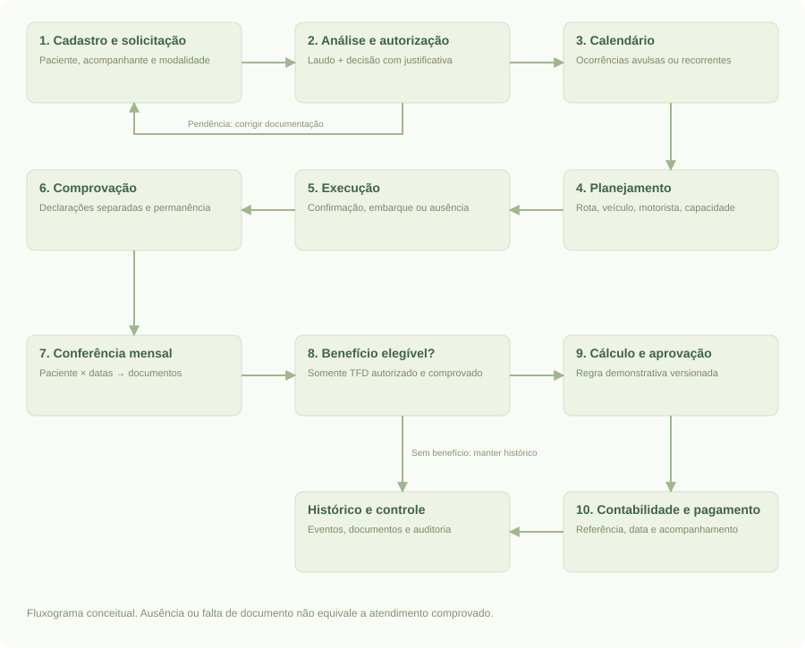
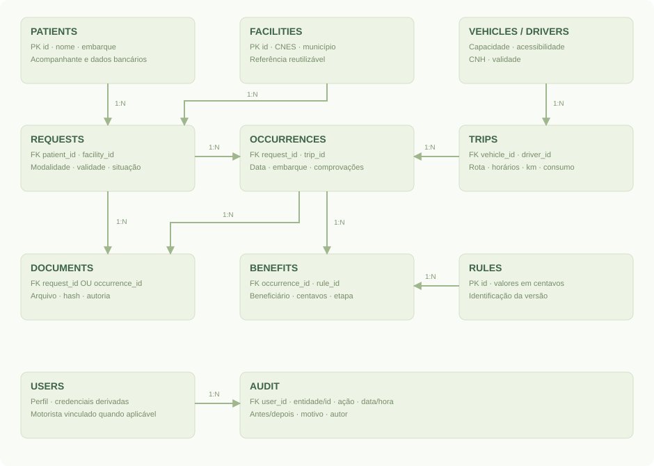

# 1. Apresentação

**Macaparana Saúde — Sistema Integrado de Gestão de Deslocamentos em Saúde** é uma proposta acadêmica acompanhada de um demonstrador funcional. Seu objetivo é organizar a solicitação de atendimento fora do município, o transporte, a comprovação e o acompanhamento das ajudas de custo, preservando vínculos entre os registros.

O trabalho responde ao problema e aos requisitos fornecidos pelo solicitante, atribuídos à rotina municipal de Macaparana/PE. Não foram realizadas entrevistas presenciais, validação jurídica, coleta de dados municipais ou implantação real. A base de demonstração é inteiramente fictícia.

O produto entregue reúne três componentes: sistema web local executável; protótipo de alta fidelidade, navegável e documentado por capturas; documentação de requisitos, arquitetura, dados, uso, testes e evolução. O recorte adotado permite demonstrar um fluxo completo dentro do prazo acadêmico, com simplificações declaradas.

## 1.1 Problema

O enunciado descreve a necessidade de integrar atividades de TFD, regulação, transporte, financeiro, faturamento e controle interno. Informações de pacientes, viagens e comprovações precisam ser conciliadas para responder quem viajou, quem foi atendido, quais documentos comprovam cada evento e qual é a situação de eventual benefício.

A hipótese de trabalho é que registros desconectados favorecem retrabalho, duplicidades e dificuldade de rastreamento. Essa hipótese vem da proposta fornecida e deve ser verificada em diagnóstico municipal; não é um resultado empírico deste trabalho.

## 1.2 Público-alvo e partes interessadas

| Público | Necessidade principal |
| --- | --- |
| Pacientes e acompanhantes | Acesso organizado ao deslocamento e orientação sobre documentos |
| Cidadãos do transporte sanitário | Viagem para consulta sem enquadramento artificial em TFD |
| TFD e regulação | Analisar, autorizar, agendar e comprovar |
| Transporte e motoristas | Planejar capacidade, confirmar passageiros e registrar execução |
| Financeiro e contabilidade | Conferir benefícios, preparar folha e acompanhar pagamento |
| Faturamento e controle interno | Consultar origem, pendências, indicadores e documentos |
| Gestão municipal | Avaliar resultados e planejar melhorias |

## 1.3 Objetivos

**Objetivo geral:** demonstrar uma solução integrada e rastreável para os deslocamentos de pacientes do SUS de Macaparana.

- Centralizar cadastros e referências reutilizáveis.
- Distinguir solicitação TFD, transporte sanitário, atendimento e benefício.
- Organizar recorrências e datas avulsas entre competências.
- Apoiar planejamento, confirmação assistida, embarque e encerramento da viagem.
- Conciliar comprovantes do paciente e do acompanhante de forma independente.
- Registrar etapas financeiras, sem executar transferências bancárias.
- Disponibilizar consulta do histórico, indicadores e auditoria.

# 2. Escopo da entrega

## 2.1 Implementado no demonstrador

Interface React integrada à API Python: login por perfis; cadastro de paciente e acompanhante vinculado; unidades com CNES informado manualmente; solicitações; anexo de laudo; análise e autorização; agenda recorrente e avulsa; veículos e motoristas; viagens com horário; validação de conflitos, lotação e acessibilidade; confirmação manual; embarque e ausência; quilômetros, consumo e custo real; anexos e comprovação; conferência mensal; benefícios demonstrativos; exportação CSV; registro do fluxo até pagamento; auditoria de alterações e downloads.

Os dados são persistidos em SQLite, incluindo o conteúdo dos anexos. A interface consulta uma API local; não depende de conexão com sistemas externos. A aplicação funciona após encerrar e reiniciar o servidor, preservando os registros salvos.

## 2.2 Simplificações conscientes

| Tema | Recorte implementado | Evolução necessária |
| --- | --- | --- |
| Acompanhante | Um acompanhante atual por paciente e autorização por solicitação | Cadastro independente, múltiplos vínculos e histórico por evento |
| Tratamento | Solicitação autorizada agrupa ocorrências únicas por data | Entidade tratamento independente, suspensões e revisão de séries |
| Trechos | Paradas ordenadas, reserva por intervalo e capacidade por segmento | Viagens distintas para retornos em outros dias |
| Viagens | Saída e retorno no mesmo dia; um destino principal e paradas ordenadas | Viagens de vários dias e otimização automática |
| Permanência | Texto relacionado ao atendimento | Períodos estruturados, pernoites e validação de regras específicas |
| Benefícios | Valor fixo ilustrativo por ocorrência e beneficiário | Tipos, vigência jurídica, elegibilidade, distância, diárias e valores homologados |
| Regras | Última versão no momento do cálculo; valor preservado após gerar | Seleção por vigência aplicável à data e processo de aprovação normativa |
| Cadastros | Criação e consulta; sem exclusão nem edição geral | Retificações com justificativa, inativação, prevenção de duplicidades avançada |
| Comprovação | Vínculo a uma ocorrência que exige embarque na viagem | Fluxos de transporte próprio, permanência e comprovação independente da frota |
| Financeiro | Registro de etapas por benefício e CSV consolidado | Lotes formais, segregação de aprovação, integração contábil e conciliação bancária |
| Contas | Sete usuários demonstrativos pré-cadastrados, incluindo faturamento | Gestão de usuários, redefinição de senha, MFA e vínculo de vários motoristas |

## 2.3 Fora desta versão

Integrações e-SUS APS, CNES/CadSUS e produção oficial; consultas a APIs externas; WhatsApp ou SMS; mapa e cálculo automático de distância; aplicativo nativo; operação offline; IA; exportação em leiautes oficiais; manutenção de frota; gestão documental com assinatura e versionamento; migração de dados; infraestrutura de produção e piloto real.

O arquivo CSV é uma **folha demonstrativa para conferência**, não um arquivo homologado de faturamento ou transmissão a sistemas oficiais.

# 3. Requisitos e rastreabilidade

Legenda: **I** = implementado no recorte; **P** = parcial/simplificado; **F** = evolução futura. Os códigos identificam requisitos do trabalho, não normas oficiais.

| Código | Requisito | Situação e evidência |
| --- | --- | --- |
| RF01 | Manter pacientes, endereço e ponto de embarque | I — Pacientes; teste de fluxo completo |
| RF02 | Manter acompanhante e dados bancários pertinentes | P — vínculo simples e campo bancário textual; sem validação bancária |
| RF03 | Reutilizar unidade de referência com CNES e especialidade | P — referência reutilizada; CNES só formato; especialidade na solicitação |
| RF04 | Anexar laudo e analisar solicitação | I — autorização bloqueada sem laudo |
| RF05 | Distinguir TFD de transporte sanitário | I — modalidades separadas; transporte não gera benefício TFD |
| RF06 | Gerar recorrências semanais e datas avulsas | I — calendário; restrição única por solicitação/data |
| RF07 | Manter continuidade entre competências | I — uma autorização pode gerar ocorrências em vários meses |
| RF08 | Planejar veículos, motoristas, capacidade e acessibilidade | I — Viagens; testes de conflito, capacidade e CNH |
| RF09 | Alocar por data e trecho | I — paradas ordenadas e capacidade por intervalo de alocação |
| RF10 | Registrar alterações de alocação com justificativa | I — retirada preserva agenda e gera auditoria; reatribuição disponível |
| RF11 | Registrar km reais, consumo e custos | I — encerramento da viagem; custos informados manualmente |
| RF12 | Confirmar antecipadamente com alternativa assistida | P — confirmação assistida; sem envio de mensagem |
| RF13 | Alimentar lista operacional do motorista | I — perfil restrito, confirmação, embarque, ausência e lista imprimível |
| RF14 | Comprovar paciente e acompanhante separadamente | I — declarações e estados independentes |
| RF15 | Conferir competência em tabela compacta de datas | I — cada célula abre a ocorrência e seus documentos |
| RF16 | Conciliar viagem, atendimento e permanência | P — vínculo e texto de permanência, sem conciliação automática externa |
| RF17 | Calcular ajuda de custo e preservar regra aplicada | P — cálculo ilustrativo por ocorrência; versão vinculada ao benefício |
| RF18 | Encaminhar folha e acompanhar pagamento | P — etapas e CSV; nenhum envio ou pagamento automático |
| RF19 | Preparar produção para sistemas oficiais | P — preparação interna, revisão, protocolo e CSV; leiaute oficial depende de homologação |
| RF20 | Relacionar indicadores a eventos de origem | P — indicadores básicos, telas de origem e auditoria; BI avançado futuro |
| RF21 | Integrar e-SUS, CNES, mapas e WhatsApp quando autorizado | F — pontos de evolução documentados; nenhuma API presumida |
| RF22 | Disponibilizar capacitação e suporte | P — manual, roteiro e registros de capacitação/chamado; equipe municipal a designar |
| RF23 | Executar e medir piloto municipal | P — plano e ferramenta de medição; execução real depende da prefeitura |

## 3.1 Requisitos não funcionais

| Código | Requisito | Implementação ou limite |
| --- | --- | --- |
| RNF01 | Persistência e integridade | SQLite, chaves estrangeiras, transações, unicidade de agenda e benefício |
| RNF02 | Controle de acesso | Sessão no servidor e permissões por ação; motorista recebe projeção reduzida |
| RNF03 | Rastreabilidade | Autor, horário UTC, ação, entidade, antes/depois e justificativa quando aplicável |
| RNF04 | Usabilidade | Português, busca, formulários, mensagens de erro e estados explícitos |
| RNF05 | Responsividade | Navegação adaptável; verificação em 1440 px e 390 px |
| RNF06 | Portabilidade da demonstração | Python 3.11+ e navegador; sem bibliotecas externas em execução |
| RNF07 | Segurança de dados | Controles básicos de aplicação; sem atestado de conformidade ou uso real |
| RNF08 | Continuidade | Procedimento de cópia/restauração; backup automático não implementado |
| RNF09 | Desempenho | Adequado à base de demonstração; sem ensaio de carga municipal |
| RNF10 | Acessibilidade | Labels, foco visível, navegação por teclado e textos; sem auditoria WCAG completa |

# 4. Regras de negócio

1. Uma solicitação possui modalidade TFD ou transporte sanitário. A classificação não é inferida da simples existência da viagem.
2. Autorizar exige laudo anexado e justificativa. As decisões disponíveis são autorizar, pendenciar e negar.
3. A solicitação autorizada possui início e fim de validade; a agenda deve respeitar esse intervalo.
4. Uma combinação de solicitação e data só pode existir uma vez. Repetir a geração preserva as ocorrências existentes.
5. Uma viagem não pode compartilhar veículo ou motorista com outra em horário sobreposto, na mesma data. A CNH deve estar válida na data planejada.
6. Um acompanhante autorizado ocupa um lugar. A acessibilidade do paciente deve ser atendida pelo veículo.
7. A ocorrência só pode ser alocada em viagem da mesma data, com capacidade disponível. O mesmo paciente não pode ocupar viagens sobrepostas.
8. Alteração de alocação exige ausência de embarque registrado; retirar um passageiro exige justificativa e mantém a ocorrência no calendário.
9. Embarcar exige confirmação. Ausência pode ser registrada sem confirmação. Viagem futura não pode ter embarque ou encerramento registrado.
10. O encerramento exige situação de embarque/ausência de todos os pacientes alocados e registro dos dados de execução.
11. Comprovação exige embarque, declaração do paciente e informação de permanência. A declaração do acompanhante é independente.
12. Somente ocorrências TFD autorizadas e comprovadas geram benefícios. O acompanhante exige autorização e comprovação próprias.
13. Há no máximo um benefício por ocorrência e beneficiário. Recalcular não duplica nem altera valores já gerados.
14. Cada benefício armazena o valor em centavos e a versão da regra usada, evitando alteração retroativa por uma nova regra.
15. As etapas financeiras são Calculado → Aprovado → Contabilidade → Pago. Envio e pagamento exigem referência; a data de pagamento não pode anteceder o atendimento nem estar no futuro.
16. As regras financeiras são exemplos acadêmicos. R$ 35,00 para paciente e R$ 25,00 para acompanhante são parâmetros fictícios, não valores legais de TFD.

# 5. Processo e casos de uso

## 5.1 Fluxo principal



O diagrama é um fluxograma conceitual, não um arquivo BPMN 2.0. O caminho financeiro aplica-se somente quando há benefício elegível. Pendências podem impedir o avanço sem apagar o histórico. A ocorrência permanece consultável após o encerramento da viagem e após o pagamento.

| Responsável | Atividades |
| --- | --- |
| Atendimento / regulação | Cadastro, solicitação, conferência de laudo, decisão e calendário |
| Transporte | Rota, veículo, motorista, alocação e confirmação assistida |
| Motorista | Lista operacional, embarque, ausência e dados de execução |
| Regulação | Conferência das declarações e permanência |
| Financeiro | Cálculo demonstrativo, aprovação, contabilidade e baixa |
| Controle interno | Consulta, documentos, exportações e eventos de auditoria |

## 5.2 Casos de uso essenciais

| Caso | Ator | Pré-condição | Resultado e alternativa |
| --- | --- | --- | --- |
| UC01 Cadastrar paciente | Regulação | Sessão autorizada | Cadastro persistido; campos obrigatórios inválidos impedem salvar |
| UC02 Analisar solicitação | Regulação | Paciente, referência e processo criados | Autoriza com laudo ou registra pendência/negativa com motivo |
| UC03 Gerar calendário | Regulação | Solicitação autorizada | Cria datas válidas; não duplica datas já existentes |
| UC04 Planejar viagem | Transporte | Veículo e motorista cadastrados | Cria viagem; conflito de horário ou CNH vencida bloqueia |
| UC05 Alocar passageiro | Transporte | Ocorrência na data da viagem | Reserva lugar; bloqueia excesso, conflito ou inacessibilidade |
| UC06 Executar viagem | Motorista | Viagem vinculada ao seu usuário | Registra confirmação/embarque/ausência e encerra execução |
| UC07 Comprovar atendimento | Regulação | Embarque registrado | Exige declaração; acompanhante permanece pendente sem sua própria prova |
| UC08 Processar benefício | Financeiro | Ocorrência TFD comprovada | Gera item único, aprova, encaminha e registra pagamento |
| UC09 Auditar histórico | Controle interno | Sessão com perfil permitido | Consulta eventos, estados e documentos de origem |

## 5.3 Permissões

| Capacidade | Admin | Regulação | Transporte | Motorista | Financeiro | Auditor |
| --- | --- | --- | --- | --- | --- | --- |
| Criar paciente, referência e solicitação | Sim | Sim | Não | Não | Não | Não |
| Autorizar, agendar e comprovar | Sim | Sim | Não | Não | Não | Não |
| Criar frota, motorista e viagem | Sim | Não | Sim | Não | Não | Não |
| Alocar ou retirar passageiro | Sim | Não | Sim | Não | Não | Não |
| Confirmar, embarcar e encerrar | Sim | Não | Sim | Só suas viagens | Não | Não |
| Ver documentos | Sim | Sim | Não | Não | Sim | Sim |
| Calcular e atualizar benefícios | Sim | Não | Não | Não | Sim | Não |
| Exportar folha | Sim | Não | Não | Não | Sim | Sim |
| Ver auditoria completa | Sim | Não | Não | Não | Não | Sim |
| Criar versão de regra | Sim | Não | Não | Não | Não | Não |

Perfis não motoristas possuem consultas compartilhadas a parte dos registros, conforme projeção da API; as permissões de alteração são verificadas no servidor. O perfil motorista recebe apenas suas viagens e informações operacionais dos passageiros, sem CPF, CNS, nascimento, dados bancários, especialidade ou arquivos. O controle de consulta dos demais perfis precisa ser refinado antes de uma implantação real.

# 6. Arquitetura e tecnologias


| Camada | Tecnologia e responsabilidade |
| --- | --- |
| Interface | React 19, JSX e CSS, compilados com Vite 8; componentes, estado, navegação, formulários e erros |
| Transporte local | HTTP em 127.0.0.1, JSON; mesma origem para interface e API |
| Aplicação | Python, biblioteca padrão; validações, permissões, regras e sessões |
| Persistência | SQLite com relacionamentos, índices, transações e parâmetros SQL |
| Documentos | Conteúdo binário no SQLite; metadados, vínculo e hash SHA-256 |
| Qualidade | unittest para domínio/HTTP; Playwright e Chrome para verificação da interface |

Foi escolhida uma aplicação monolítica modular para reduzir preparação do ambiente e permitir entrega local reproduzível. SQLite permite um banco em arquivo, sem processo de banco separado. Isso atende à demonstração, não substitui uma avaliação de infraestrutura e concorrência para o município. [Documentação oficial do SQLite no Python](https://docs.python.org/3/library/sqlite3.html).

`server.py` trata HTTP e sessão; `app/domain.py` concentra regras e autorização; `app/seed.py` cria apenas a base inicial fictícia; `app/schema.sql` descreve tabelas. Em `frontend/src`, `main.jsx` gerencia autenticação e estado com hooks/Context; `pages.jsx` reúne páginas; `forms.jsx` reúne formulários; `details.jsx` apresenta históricos e operações; `ui.jsx` oferece componentes compartilhados. O Vite gera `static/build`, servido pelo Python; não há dependência de CDN durante a apresentação.

React é usado na renderização das telas e no controle dos estados de busca, filtro, diálogo e operação em andamento. Dados exibidos como texto são escapados pelo React. O frontend não define a autorização: as mesmas permissões e regras permanecem na API Python. O arquivo `frontend/package-lock.json` fixa as dependências instaladas. Node.js 24 LTS é necessário apenas para desenvolvimento e recompilação.

O sistema roda somente em loopback. Não há serviço de nuvem, publicação externa, telemetria ou integração ativa. O navegador precisa estar no computador do servidor nesta configuração.

## 6.1 API local

| Método e caminho | Contrato |
| --- | --- |
| POST /api/login | Recebe username/password; retorna cookie HttpOnly de sessão |
| POST /api/logout | Invalida sessão no servidor e expira cookie |
| GET /api/state | Retorna registros permitidos ao perfil, sem conteúdo binário dos documentos |
| POST /api/action | Recebe action e data; valida permissão e regra, grava transação e auditoria |
| GET /api/documents/{id} | Download autenticado para perfis autorizados; audita acesso |
| GET /api/export | CSV demonstrativo de todos os benefícios, com datas para filtro externo |

Exemplo de operação:

```json
{
  "action": "request.decide",
  "data": {
    "id": 9,
    "status": "Autorizada",
    "reason": "Análise documental demonstrativa concluída"
  }
}
```

POST exige `Content-Type: application/json` e `X-App: macaparana`. Se houver cabeçalho Origin, ele deve corresponder à origem local. A aplicação não habilita CORS. Falhas de sessão retornam 401, validações e restrições de perfil retornam 400, conflitos de integridade retornam 409 e origem inválida retorna 403.

| Família | Ações aceitas em /api/action |
| --- | --- |
| Cadastro | patient.create, facility.create, vehicle.create, driver.create |
| Solicitação e agenda | request.create, request.decide, schedule.create |
| Transporte | trip.create, trip.allocate, trip.release, trip.close |
| Ocorrência | occurrence.confirm, occurrence.board, occurrence.prove |
| Documentos | document.create |
| Financeiro | benefit.calculate, benefit.advance, rule.create |

O contrato de campos e validações está implementado em `app/domain.py`; o exemplo é uma API de comandos do demonstrador, sem alegação de conformidade com padrão externo de interoperabilidade.

# 7. Modelo de dados



| Tabela | Campos e propósito |
| --- | --- |
| users | Usuário, nome, perfil, salt, derivação da senha e vínculo opcional de motorista |
| patients | Nome, CPF opcional único, CNS, nascimento, contato, endereço, embarque, acessibilidade, acompanhante e banco |
| facilities | Unidade reutilizável com nome, CNES único, município e situação |
| requests | Paciente, referência, modalidade, especialidade, acompanhante, validade, situação e motivo |
| occurrences | Solicitação, data, viagem opcional, confirmação, embarque, atendimento, acompanhante e permanência |
| vehicles | Modelo, placa única, capacidade, acessibilidade e situação |
| drivers | Nome, CNH, validade e situação |
| trips | Data, horários, rota, veículo, motorista, km estimados/reais, litros, custo e notas |
| documents | Vínculo exclusivo à solicitação ou ocorrência, tipo, arquivo, hash, data e usuário |
| rules | Valores em centavos, identificação da versão e data de criação |
| benefits | Ocorrência, beneficiário, versão da regra, valor, etapa, referência e data de pagamento |
| audit | Usuário, autor, ação, entidade/id, antes, depois, justificativa e data/hora |

Relações principais: paciente 1:N solicitação; referência 1:N solicitação; solicitação 1:N ocorrência; viagem 1:N ocorrências alocadas; veículo e motorista 1:N viagens; ocorrência 1:N documentos e benefícios. Um documento aponta para solicitação **ou** ocorrência. Cada benefício aponta para uma regra imutável por uso.

Restrições relevantes: `UNIQUE(request_id, date)` evita duplicidade de agenda; `UNIQUE(occurrence_id, beneficiary)` evita duplicidade de benefício; chaves estrangeiras preservam vínculos; `CHECK` restringe modalidades, beneficiários e valores. O esquema completo está em `app/schema.sql`.

O modelo não permite vários acompanhantes independentes nem comprovação de ida/retorno separada. O vínculo `users.driver_id` da conta demonstrativa é configurado na carga inicial, sem interface de administração nesta versão.

# 8. Interface e protótipo

O protótipo usa a mesma interface do sistema funcional. As capturas documentam telas reais, não imagens de funcionalidades inexistentes. A galeria é disponibilizada em `prototipo.html` e em `Prototipo-de-Telas.pdf`.

| Tela | Finalidade |
| --- | --- |
| Acesso | Escolher perfil demonstrativo e iniciar sessão |
| Visão geral | Pacientes, viagens do dia, pendências e custo de transporte |
| Pacientes | Buscar cadastro e abrir histórico de solicitações e ocorrências |
| Solicitações | Acompanhar análise, anexar laudo, decidir e agendar |
| Calendário | Visualizar datas por competência e abrir o atendimento |
| Viagens | Planejar, alocar, confirmar e executar |
| Operação da viagem | Lista de passageiros, acompanhante, embarque, ausência e encerramento |
| Conferência mensal | Matriz paciente/data com acesso aos comprovantes |
| Ajudas de custo | Competência, valores, estágios financeiros e exportação |
| Frota e referências | Veículos, motoristas e estabelecimentos |
| Auditoria | Eventos com estados anterior e posterior |
| Entrega acadêmica | Documentação, protótipo e roteiro |

O visual emprega cores suaves, estados acompanhados de texto, navegação lateral, tabelas compactas e formulários em diálogo. Em celulares, a navegação é recolhida; tabelas amplas mantêm rolagem horizontal dentro de seus contêineres. A lista operacional pode ser aberta para impressão, sem diagnóstico ou informação bancária.

# 9. Segurança, proteção de dados e limites

A LGPD inclui dados de saúde na definição de dados pessoais sensíveis. Esta constatação orienta a separação de acesso e o uso de dados fictícios neste demonstrador; não significa que o produto esteja homologado ou que sua conformidade tenha sido auditada. [Lei nº 13.709/2018, texto compilado](https://www.planalto.gov.br/ccivil_03/_ato2015-2018/2018/lei/l13709compilado.htm).

## 9.1 Controles implementados

- Senhas armazenadas por derivação PBKDF2-HMAC-SHA256, salt individual e comparação resistente a diferenças de tempo.
- Sessão aleatória no servidor, expiração de oito horas e cookie HttpOnly/SameSite=Strict.
- Limitação básica de tentativas de login por IP, em memória.
- Verificação de permissão no servidor para cada ação.
- Projeção reduzida dos dados do motorista e restrição às suas viagens.
- SQL parametrizado, relações e transações para alterações.
- Escapamento de texto pelo React, cabeçalhos de segurança e restrição de origem de POST.
- Anexos de até 4 MB, extensões permitidas, download autenticado e hash SHA-256.
- Banco e código-fonte fora das rotas de arquivos públicos.
- Auditoria de mutações, login, download de documentos e exportação.

## 9.2 Limitações que impedem uso com dados reais

As credenciais são públicas e demonstrativas. Não há HTTPS nesta execução local, criptografia do arquivo de banco, MFA, gestão de credenciais, antivírus de anexos, trilha resistente à adulteração, registro de todas as consultas, retenção automática, teste de invasão ou garantia de disponibilidade. O hash do arquivo identifica conteúdo, mas não valida autenticidade clínica nem assinatura.

Antes de qualquer piloto real, será necessário avaliar o tratamento de dados com o município, definir responsabilidades e perfis, homologar regras, implantar infraestrutura protegida, garantir cópias de segurança e realizar testes e treinamento. A base legal e a política de retenção dependem da finalidade e das decisões institucionais; não foram definidas por este trabalho.

# 10. Instalação e operação

## 10.1 Primeiro acesso

1. Extraia o pacote para uma pasta com permissão de escrita.
2. Confirme que Python 3.11+ está disponível com `python --version`.
3. Execute `iniciar.bat` no Windows ou `python server.py` no terminal da pasta.
4. Abra `http://localhost:8000`.
5. Entre como `admin` e senha `demo123`.
6. Mantenha o terminal aberto durante a demonstração.

Não é necessário instalar dependências com pip ou npm para apresentar o pacote: o build React está incluído. O banco `data/macaparana.db` é criado automaticamente na primeira inicialização; a carga fictícia não é repetida quando já existem usuários. Para alterar o frontend, use Node.js 24 LTS, execute `npm ci` e `npm run build` em `frontend`. No desenvolvimento, `npm run dev` oferece recarga automática e proxy para a API Python.

## 10.2 Contas de demonstração

Usuários: `admin`, `regulacao`, `transporte`, `motorista`, `financeiro`, `auditor`. Senha comum: `demo123`. A conta motorista é vinculada apenas ao motorista Carlos da base inicial. Os nomes e identificadores são demonstrativos.

## 10.3 Arquivos e continuidade

Faça cópia do arquivo `data/macaparana.db` com o servidor parado. Preserve o original. Para validar uma cópia, execute outra instância com caminho e porta diferentes, por exemplo `python server.py --port 8002 --db data/copia-para-validacao.db`, usando uma cópia previamente criada do banco. Verifique contagens, documentos e histórico. Sessões não persistem após reiniciar o servidor; os dados persistem.

Para iniciar uma base de demonstração limpa sem apagar registros, escolha um novo caminho: `python server.py --db data/nova-demonstracao.db`. A nova base recebe a carga inicial fictícia.

## 10.4 Problemas comuns

| Sintoma | Procedimento |
| --- | --- |
| Página não abre | Verifique se o terminal está aberto e se a URL/porta coincide com o servidor |
| Porta ocupada | Use `python server.py --port 8002` e abra a nova porta |
| Python não encontrado | Instale/configure Python compatível ou use o executável disponível no ambiente |
| Sessão encerrada | Entre novamente; registros salvos permanecem no banco |
| Não autoriza | Anexe laudo e informe justificativa |
| Não aloca | Confira data, veículo acessível, lotação com acompanhante e conflitos |
| Não comprova | Registre embarque e anexe declaração; acompanhante exige seu próprio documento |
| Não gera benefício | Confira modalidade TFD, comprovação e competência; item existente não será duplicado |

# 11. Plano de testes e evidências

## 11.1 Testes automatizados

Execução: `python -m unittest discover -s tests -v`. As bases de teste são temporárias e independentes do banco de apresentação.

| Grupo | Verificações |
| --- | --- |
| Autorização | Laudo obrigatório, decisão persistida e auditoria |
| Agenda | Recorrência entre meses, repetição idempotente e validade da autorização |
| Planejamento | Conflito de veículo/motorista, CNH vencida, acompanhante na lotação e acessibilidade |
| Execução | Confirmação exigida; embarque não comprova atendimento |
| Comprovação | Declaração do paciente e acompanhante tratadas separadamente |
| Benefício | Transporte sanitário excluído, geração sem duplicatas, preservação de valor/regra |
| Pagamento | Ordem de etapas, referência contábil e validação de data |
| Permissões | Motorista restrito, dados reduzidos e ações financeiras bloqueadas |
| HTTP | Sessão/logout, rejeição de origem externa, arquivos privados, documentos e exportação |
| Fluxo completo | Novo paciente até registro de pagamento |

São 16 testes de domínio e 5 testes HTTP. O relatório gerado da execução acompanha a entrega em `resultado-testes.txt`.

## 11.2 Verificação em navegador

O script `scripts/browser_check.py` acessa as telas, gera 13 capturas e verifica ausência de erros JavaScript e de transbordamento horizontal da página em largura de 390 px. Tabelas podem rolar dentro do próprio contêiner.

O script `scripts/e2e_flow.py` utiliza uma instância temporária separada para preencher formulários: cadastro, solicitação, upload de laudo, autorização, agendamento, criação de viagem, alocação, confirmação, embarque, encerramento, declaração, comprovação, cálculo, aprovação, contabilidade e pagamento. Ao final recarrega a tela para verificar persistência. A evidência está em `teste-navegador.json`.

O script adicional `scripts/capture_flows.py` percorre a interface React em outra base temporária, na porta 8004, e salva capturas de cada etapa em `docs/fluxos`. Abrange TFD com acompanhante, pendência e negativa, recorrências, capacidade, execução, declarações separadas, financeiro, CSV, regra versionada, transporte sanitário sem benefício e os seis perfis. `docs/fluxos/manifesto.json` registra resultados e descrições; `fluxos.html` e `Fluxos-Funcionando.pdf` organizam as evidências. Os prints demonstram a integração local React → API Python → SQLite, não integrações externas.

Os testes sustentam o funcionamento do recorte acadêmico. Não equivalem a homologação municipal, teste de carga, auditoria de segurança ou validação legal dos benefícios.

## 11.3 Critérios de aceite da entrega acadêmica

- Iniciar com Python e abrir no navegador sem configurar banco externo.
- Executar um cenário completo, mantendo vínculo entre paciente, solicitação, ocorrência, viagem, documento e benefício.
- Apresentar tratamento distinto para transporte sanitário.
- Demonstrar bloqueios relevantes e permissões do motorista.
- Preservar dados após recarregar/reiniciar.
- Entregar documentação, protótipo e roteiro consistentes com o comportamento implementado.

# 12. Indicadores e proposta de piloto

## 12.1 Indicadores disponíveis

O painel apresenta quantidade de pacientes cadastrados, viagens do dia, solicitações em análise/pendentes, custo de transporte realizado na competência, embarques de pacientes por mês, embarques sem comprovação e agenda futura sem alocação. A área de viagens apresenta km realizados, lugares reservados incluindo acompanhantes e viagens encerradas. A área financeira apresenta valores por etapa e competência.

Esses números são calculados a partir da base local fictícia. Não descrevem o desempenho real de Macaparana. Custo de transporte é separado de ajuda de custo; o total financeiro não pode ser interpretado automaticamente como custo integral do serviço.

## 12.2 Indicadores propostos para validação no piloto

| Indicador | Definição proposta |
| --- | --- |
| Ocupação por trecho | Lugares utilizados / lugares ofertados no mesmo trecho × 100 |
| Ausência | Pacientes confirmados que faltaram / pacientes confirmados × 100 |
| Custo por passageiro transportado | Custos reais de viagens / embarques de pacientes e acompanhantes efetivamente registrados |
| Km por passageiro | Km reais / passageiros efetivamente transportados, com regra de contagem definida |
| Tempo de autorização | Data/hora da decisão menos data/hora do protocolo |
| Tempo de conferência | Tempo de trabalho medido por competência |
| Tempo de pagamento | Data de pagamento menos data de aprovação |
| Completude documental | Ocorrências com todos os documentos exigidos / ocorrências analisadas × 100 |

Denominadores zero devem produzir indicador indisponível, nunca divisão inválida. A versão atual não registra embarque de acompanhante separadamente; portanto, a medição real de passageiros por trecho exige ampliar o modelo antes de usar esses indicadores no piloto.

## 12.3 Plano proposto, não executado

1. Diagnóstico: entrevistar usuários, mapear documentos, sistemas existentes, volume e tempos atuais.
2. Homologação: definir regras locais e responsabilidades, validar proteção de dados, infraestrutura e critérios de aceite.
3. Treinamento: usar dados fictícios para praticar cenários e pendências; registrar dúvidas.
4. Piloto controlado: selecionar equipe e janela de 8 a 12 semanas, após condições institucionais e técnicas atendidas.
5. Medição: comparar mesma unidade de análise antes/depois, registrando tamanho da amostra e mudanças de contexto.
6. Avaliação: consolidar erros, retrabalho, tempo, completude, ocupação e rastreabilidade; decidir ajustes e expansão.

Não foram estabelecidas metas percentuais sem linha de base. Não foram reaproveitadas como orçamento as estimativas monetárias da proposta inicial, pois faltam volumes, infraestrutura, contratação e dimensionamento da equipe.

# 13. Evolução e cronograma proposto

| Etapa | Entregas | Dependência |
| --- | --- | --- |
| Entrega acadêmica atual | Demonstrador, documentos, protótipo e testes | Concluída no recorte documentado |
| Validação do domínio | Entrevistas, documentos, fluxo e regras homologadas | Acesso às equipes municipais |
| Adequação do modelo | Acompanhantes independentes, tratamentos, trechos e permanências estruturadas | Validação do domínio |
| Preparação de produção | Infraestrutura, banco adequado, segurança, backups, contas e observabilidade | Recursos e responsáveis definidos |
| Integrações | Estudo de interfaces, credenciais, contratos, homologação e leiautes | Autorização e documentação oficial disponível |
| Piloto | Treinamento, operação assistida, indicadores e relatório | Aceite técnico e institucional |
| Expansão | Correções, suporte e replicação parametrizada | Avaliação do piloto |

Não se presume que e-SUS APS permita leitura dos dados desejados nem que CNES, mapas ou WhatsApp estejam disponíveis por uma API gratuita e autorizada. Cada integração precisa de levantamento próprio. O demonstrador não estabelece cronograma contratual de implantação.

# 14. Referências e origem dos requisitos

- Enunciado e proposta estruturada fornecidos pelo solicitante nesta atividade, setembro de 2026. Fonte dos requisitos de público-alvo, solução esperada e fluxo municipal. Não constituem validação institucional realizada pela equipe do demonstrador.
- [Ministério da Saúde — Portaria SAS/MS nº 55, de 24 de fevereiro de 1999](https://bvsms.saude.gov.br/bvs/sas/1999/prt0055_24_02_1999.html). Referência histórica do TFD; valores e regras do demonstrador não foram derivados desta portaria.
- [Ministério da Saúde — Tratamento Fora do Domicílio, wiki de regulação](https://wiki.saude.gov.br/regulacao/index.php/Tratamento_Fora_do_Domic%C3%ADlio_%28TFD%29). Página institucional que apresenta TFD e menciona sua consolidação normativa; consulta não substitui validação estadual/municipal.
- [Brasil — Lei nº 13.709/2018, texto compilado](https://www.planalto.gov.br/ccivil_03/_ato2015-2018/2018/lei/l13709compilado.htm). Referência sobre proteção de dados e classificação dos dados de saúde.
- [Python Software Foundation — sqlite3](https://docs.python.org/3/library/sqlite3.html). Referência técnica da persistência usada.
- [React — Adicionar React a um projeto existente](https://react.dev/learn/add-react-to-an-existing-project). Referência para a interface por componentes e montagem da raiz React.
- [Vite — Build para distribuição](https://vite.dev/guide/build). Referência da compilação dos arquivos de frontend servidos pelo Python.

Referências consultadas em 29 de setembro de 2026. A documentação descreve a versão acadêmica 1.1 (React + Python) e deve ser revista quando o sistema evoluir.

# 18. Complemento da revisão de escopo — 04/10/2026

A revisão acrescenta rotas por trecho, perfil de faturamento, preparação de produção, indicadores, registro de medições do piloto, capacitação, suporte e backup consistente. Consulte [Verificação completa do escopo](verificacao-escopo.html) e [Manual de operação](operacao.html). As limitações históricas desta documentação relativas à reserva integral e ausência de preparação interna são substituídas pelo complemento. Integrações oficiais, implantação e piloto real continuam condicionados à prefeitura.
